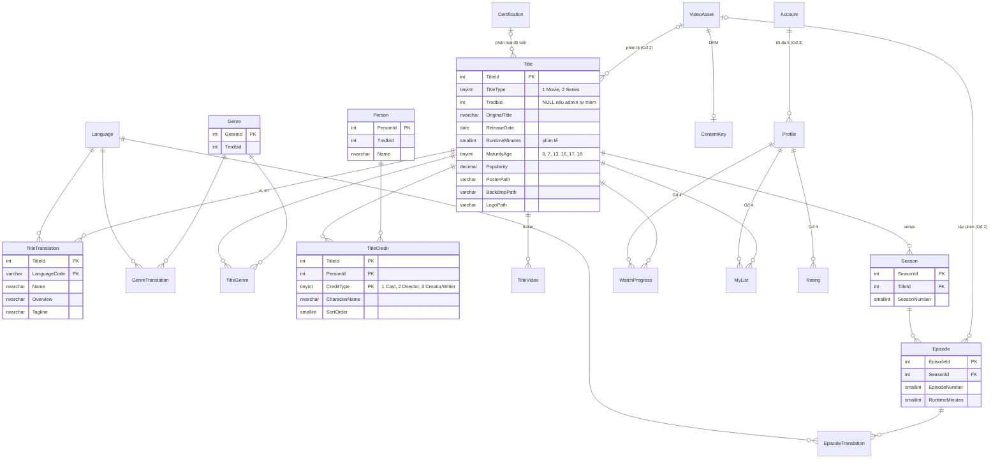

# ERD

Sơ đồ dưới đây là thiết kế cho toàn hệ thống, nhưng **mỗi bảng chỉ được tạo ở giai đoạn cần đến nó** (cột "Giai đoạn").
Giai đoạn 1 tạo schema `catalog`. Các bảng của schema `media`, `identity`, `playback` chỉ được phác thảo trước để thấy chỗ nối, chưa chốt chi tiết.

| Schema | Bảng | Giai đoạn |
|---|---|---|
| `catalog` | Language, Certification, Title, TitleTranslation, Genre, GenreTranslation, TitleGenre, Person, TitleCredit, TitleVideo, Season, Episode, EpisodeTranslation | **1** |
| `media` | VideoAsset (link Title/Episode tới thư mục đã đóng gói trong `media/packaged`) | 2 |
| `drm` | ContentKey (đã có), sẽ nối với VideoAsset | 0 → 2 |
| `identity` | Account, RefreshToken, Profile | 3 |
| `playback` | WatchProgress, MyList, Rating | 4 |
| `stats` | DailyTitleViews (snapshot cho Top 10) | 5 |

## Các quyết định thiết kế

**Đa ngôn ngữ (vi + en).** Các trường dịch được (tên, mô tả, tagline) nằm ở bảng `...Translation`, khóa chính là `(Id, LanguageCode)`.
Bảng `Title` chỉ giữ dữ liệu không phụ thuộc ngôn ngữ. SP đọc dữ liệu sẽ fallback **theo từng trường**:
`COALESCE(vi.Overview, en.Overview)`, `COALESCE(vi.Name, en.Name, t.OriginalTitle)`.
Fallback theo từng trường vì TMDB hay có tên tiếng Việt nhưng thiếu mô tả. Chuỗi rỗng được lưu thành `NULL` (`NULLIF(x, '')`), để `COALESCE` hoạt động đúng.

**Một bảng `Title` cho cả phim lẻ và series** (`TitleType`). Netflix trộn cả hai trong cùng một row ("Phổ biến trên Netflix"),
nên một bảng giúp query browse không phải `UNION`. Cột chỉ dành cho phim lẻ (`RuntimeMinutes`) được để NULL với series.
Season và Episode là bảng con của series.

**`TmdbId` cho phép NULL.** Phim do admin tự thêm (Giai đoạn 8) không có id TMDB. Index unique dùng filtered index
`(TitleType, TmdbId) WHERE TmdbId IS NOT NULL`. Cần có `TitleType` trong index vì id phim lẻ và id series của TMDB có thể trùng nhau.

**Phân loại độ tuổi.** TMDB trả mã phân loại theo từng quốc gia (VN: P/K/T13/T16/T18; US: G/PG/PG-13/R/NC-17/TV-Y/.../TV-MA).
Bảng tra `catalog.Certification (CountryCode, Code) → MinAge` quy đổi các mã này về một con số.
`Title.MaturityAge` được tính lúc ghi dữ liệu (denormalize). Nhờ vậy, khi lọc cho profile Kids ở Giai đoạn 3 chỉ cần `WHERE MaturityAge <= @MaxAge`, không phải join.
Phim **không rõ phân loại thì `MaturityAge` là NULL và bị coi như 18+** (mặc định an toàn).

**Ảnh lưu đường dẫn TMDB** (`/abc.jpg`), không lưu URL đầy đủ. FE tự ghép `https://image.tmdb.org/t/p/<size><path>`.
Nhờ đó FE tự chọn kích thước ảnh: poster nhỏ cho row, backdrop lớn cho hero.

## Index (và lý do)

| Index | Phục vụ |
|---|---|
| `Title` PK clustered `TitleId` | trang chi tiết, khóa ngoại |
| `UX_Title_Tmdb (TitleType, TmdbId) WHERE TmdbId IS NOT NULL` | seeder upsert theo id TMDB |
| `IX_Title_Type_Popularity (TitleType, Popularity DESC) INCLUDE (...)` | row "Phổ biến" theo loại; phủ (cover) đủ cột để không phải key lookup |
| `TitleTranslation` PK `(TitleId, LanguageCode)` | lấy bản dịch theo title, seek đúng 1–2 dòng |
| `TitleGenre` PK `(TitleId, GenreId)` + `IX (GenreId, TitleId)` | 2 chiều: thể loại của 1 phim / các phim của 1 thể loại (row theo thể loại) |
| `TitleCredit` PK `(TitleId, PersonId, CreditType)` + `IX (PersonId)` | dàn diễn viên của 1 phim / các phim có diễn viên X |
| `UX_Season (TitleId, SeasonNumber)`, `UX_Episode (SeasonId, EpisodeNumber)` | chọn season, tính "tập kế tiếp" |

## Ghi dữ liệu: `...UpsertFromJson`

Seeder gửi **một tài liệu JSON cho mỗi title** (theo format riêng của dự án, không phải JSON thô của TMDB) vào
`catalog.usp_Title_UpsertFromJson`. SP dùng `OPENJSON ... WITH (...)` để tách JSON ra thành các bảng, và làm mọi việc trong **một transaction**:
upsert `Title` → upsert `Person` (set-based) → thay toàn bộ bảng con (translation, genre, credit, video).
Một title có nhiều tầng dữ liệu (dịch, diễn viên, video...), nên gửi một tài liệu JSON gọn hơn nhiều so với 5 TVP riêng.
Còn khi chỉ là danh sách phẳng (như danh sách KID của DRM) thì vẫn dùng TVP.
