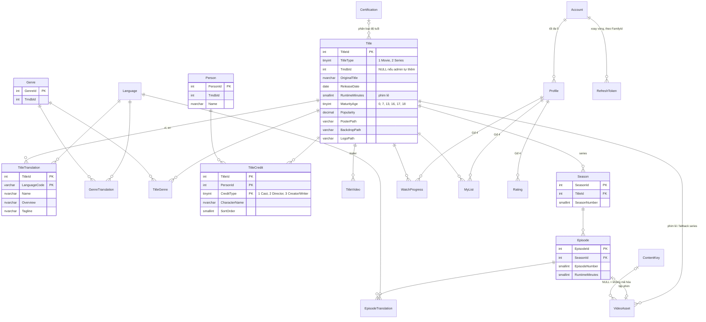

# ERD

Sơ đồ dưới đây là thiết kế cho toàn hệ thống, nhưng **mỗi bảng chỉ được tạo ở giai đoạn cần đến nó** (cột "Giai đoạn").
Giai đoạn 1 tạo schema `catalog`, Giai đoạn 2 tạo `media.VideoAsset`, Giai đoạn 3 tạo schema `identity`. Các bảng của schema `playback` chỉ được phác thảo trước để thấy chỗ nối, chưa chốt chi tiết.

| Schema | Bảng | Giai đoạn |
|---|---|---|
| `catalog` | Language, Certification, Title, TitleTranslation, Genre, GenreTranslation, TitleGenre, Person, TitleCredit, TitleVideo, Season, Episode, EpisodeTranslation | **1** |
| `media` | VideoAsset (link Title/Episode tới thư mục đã đóng gói trong `media/packaged`) | **2** |
| `drm` | ContentKey, được VideoAsset tham chiếu qua `ContentKeyId` | 0, nối ở 2 |
| `identity` | Account, Profile, RefreshToken | **3** |
| `playback` | WatchProgress, MyList, Rating | 4 |
| `stats` | DailyTitleViews (snapshot cho Top 10) | 5 |

## Các quyết định thiết kế

**Đa ngôn ngữ (vi + en).** Các trường dịch được (tên, mô tả, tagline) nằm ở bảng `...Translation`, khóa chính là `(Id, LanguageCode)`.
Bảng `Title` chỉ giữ dữ liệu không phụ thuộc ngôn ngữ. SP đọc dữ liệu sẽ fallback **theo từng trường**:
`COALESCE(vi.Overview, en.Overview)`, `COALESCE(vi.Name, en.Name, t.OriginalTitle)`.
Fallback theo từng trường vì TMDB hay có tên tiếng Việt nhưng thiếu mô tả. Chuỗi rỗng được lưu thành `NULL` (`NULLIF(x, '')`), để `COALESCE` hoạt động đúng.

**Một bảng `Title` cho cả phim lẻ và series** (`TitleType`). Trang browse trộn cả hai loại trong cùng một row ("Phổ biến"),
nên một bảng giúp query browse không phải `UNION`. Cột chỉ dành cho phim lẻ (`RuntimeMinutes`) được để NULL với series.
Season và Episode là bảng con của series.

**`TmdbId` cho phép NULL.** Phim do admin tự thêm (Giai đoạn 8) không có id TMDB. Index unique dùng filtered index
`(TitleType, TmdbId) WHERE TmdbId IS NOT NULL`. Cần có `TitleType` trong index vì id phim lẻ và id series của TMDB có thể trùng nhau.

**Phân loại độ tuổi.** TMDB trả mã phân loại theo từng quốc gia (VN: P/K/T13/T16/T18; US: G/PG/PG-13/R/NC-17/TV-Y/.../TV-MA).
Bảng tra `catalog.Certification (CountryCode, Code) → MinAge` quy đổi các mã này về một con số.
`Title.MaturityAge` được tính lúc ghi dữ liệu (denormalize). Nhờ vậy, khi lọc cho profile Kids ở Giai đoạn 3 chỉ cần `WHERE MaturityAge <= @MaxAge`, không phải join.
Phim **không rõ phân loại thì `MaturityAge` là NULL và bị coi như 18+** (mặc định an toàn).

**Ảnh lưu đường dẫn TMDB** (`/abc.jpg`), không lưu URL đầy đủ. FE tự ghép `https://image.tmdb.org/t/p/<size><path>`.
Nhờ đó FE tự chọn kích thước ảnh: poster nhỏ cho row, backdrop lớn cho hero.

## Index (và lý do)

| Index | Phục vụ |
|---|---|
| `Title` PK clustered `TitleId` | trang chi tiết, khóa ngoại |
| `UX_Title_Tmdb (TitleType, TmdbId) WHERE TmdbId IS NOT NULL` | seeder upsert theo id TMDB |
| `IX_Title_Type_Popularity (TitleType, Popularity DESC) INCLUDE (...)` | row "Phổ biến" theo loại; phủ (cover) đủ cột để không phải key lookup |
| `TitleTranslation` PK `(TitleId, LanguageCode)` | lấy bản dịch theo title, seek đúng 1–2 dòng |
| `TitleGenre` PK `(TitleId, GenreId)` + `IX (GenreId, TitleId)` | 2 chiều: thể loại của 1 phim / các phim của 1 thể loại (row theo thể loại) |
| `TitleCredit` PK `(TitleId, PersonId, CreditType)` + `IX (PersonId)` | dàn diễn viên của 1 phim / các phim có diễn viên X |
| `UX_Season (TitleId, SeasonNumber)`, `UX_Episode (SeasonId, EpisodeNumber)` | chọn season, tính "tập kế tiếp" |
| `UX_VideoAsset_Title_Episode (TitleId, EpisodeId)` | "title có video không?" (cột `HasVideo` ở browse) và chọn video để phát đều là seek theo `TitleId`. Unique nên mỗi phim/tập chỉ có 1 video; NULL được coi là bằng nhau nên mỗi title có tối đa 1 dòng `EpisodeId IS NULL` |
| `Title.VoteAverage`, `Title.ReleaseDate`: **cố ý không có index** | row "Đánh giá cao" và "Mới phát hành" scan vài trăm dòng + Top N Sort, chỉ vài ms. Thêm index chỉ làm chậm seeder; xem lại khi catalog lên hàng chục nghìn title |

## Ghi dữ liệu: `...UpsertFromJson`

Seeder gửi **một tài liệu JSON cho mỗi title** (theo format riêng của dự án, không phải JSON thô của TMDB) vào
`catalog.usp_Title_UpsertFromJson`. SP dùng `OPENJSON ... WITH (...)` để tách JSON ra thành các bảng, và làm mọi việc trong **một transaction**:
upsert `Title` → upsert `Person` (set-based) → thay toàn bộ bảng con (translation, genre, credit, video).
Một title có nhiều tầng dữ liệu (dịch, diễn viên, video...), nên gửi một tài liệu JSON gọn hơn nhiều so với 5 TVP riêng.
Còn khi chỉ là danh sách phẳng (như danh sách KID của DRM) thì vẫn dùng TVP.

## Đọc dữ liệu cho trang browse: `catalog.usp_Browse_GetHome`

Một lần gọi trả về **2 result set**: hero (0–1 dòng) và **danh sách item phẳng** `(RowOrder, RowKey, RowName, Position, ...cột thẻ phim)`.
API gom danh sách phẳng thành các row (Dapper multi-mapping, tách cột ở `TitleId`). Lý do không trả mỗi row một result set: số row thể loại phụ thuộc dữ liệu.

- Mỗi row có một **`Layout`** do SP quyết định: `standard` (thẻ ngang 16:9 có logo phim), `top10` (poster + số thứ tự lớn), `poster` (poster dọc 2:3).
  FE chỉ việc vẽ theo layout, nên đổi bố cục trang chủ chỉ cần sửa SP.
- Các title được lọc độ tuổi **một lần** vào bảng tạm `#visible`, mọi row đọc từ đó.
- Mỗi row được đổ vào bảng tạm `#items` bằng **một `INSERT ... SELECT TOP (n)` riêng**, theo thứ tự: 2 hàng Top 10 trước, rồi các row còn lại.
- **Giảm lặp phim giữa các row**: row sau sắp xếp theo `Seen` trước (title đã có ở row trước = 1, đẩy xuống cuối), rồi mới theo tiêu chí của row.
  Row vẫn đủ phim, nhưng các thẻ đầu tiên của mỗi row khác nhau. Đổi lại, các row này không còn dừng sớm trên index seek mà cần Top N Sort; với vài trăm title chỉ tốn vài ms.
  Hai hàng Top 10 là bảng xếp hạng nên không bị sắp lại.
- Row thể loại: chọn các thể loại có nhiều phim nhất (tối thiểu 5 phim), rồi `CROSS APPLY` lấy TOP n phim của từng thể loại qua `IX_TitleGenre_Genre`.
- Mỗi thẻ có thêm `Genres` (tối đa 3 tên, ghép bằng `STRING_AGG`, bỏ tiền tố "Phim ") và `IsRecent` (phát hành trong 60 ngày) cho thẻ phóng to khi rê chuột và nhãn "MỚI".
- Cột text (tên, mô tả) chỉ được join **một lần ở cuối** qua `catalog.fn_TitleText` (inline TVF, fallback từng trường).
- Lọc độ tuổi: `ISNULL(MaturityAge, 18) <= @AgeLimit`, `@MaxMaturityAge` NULL = không giới hạn. Giai đoạn 3 truyền 12 cho profile Kids.
- Hero: chọn trong 10 phim phổ biến nhất, ưu tiên phim có backdrop và có video, đổi mỗi ngày bằng `ABS(CHECKSUM(TitleId, @Today))`
  (thứ tự giả ngẫu nhiên nhưng cố định trong ngày, F5 không bị nhảy phim).

## Phát video: `media.usp_Playback_Get`

Phim lẻ: video của title (`EpisodeId IS NULL`). Series: tập đầu tiên có video (season 1 trước, "Specials" season 0 xếp cuối),
không có tập nào thì dùng video cấp series. API ghép `MediaPath` thành `/media/<MediaPath>/manifest.mpd` và, nếu có `ContentKeyId`,
trả thêm `drm: { keySystem: "org.w3.clearkey", licenseUrl }`. Key không bao giờ đi qua endpoint này.

`MediaPath` được kiểm tra 2 lớp vì nó sẽ thành đường dẫn file: `CHECK (MediaPath NOT LIKE '%[^a-zA-Z0-9_-]%')` trong DB và kiểm tra lại ở API.
## Đăng nhập và hồ sơ (schema `identity`, Giai đoạn 3)

Tự làm bằng SP + JWT, **không dùng ASP.NET Core Identity** (Identity dựa trên EF Core, còn dự án này chỉ dùng Dapper + SP).
API chỉ mượn `PasswordHasher` của Identity (PBKDF2, có salt, có version), nên SQL chỉ lưu và trả về chuỗi hash, không bao giờ so mật khẩu.

| Bảng | Điểm đáng chú ý |
|---|---|
| `Account` | `UQ_Account_Email` trên collation không phân biệt hoa thường, nên `A@x.com` và `a@x.com` là một. `FailedLoginCount` + `LockoutUntil`: sai 5 lần liên tiếp thì khóa 5 phút |
| `Profile` | `MaxMaturityAge AS (CASE WHEN IsKids = 1 THEN 12 END) PERSISTED`: cột tính toán, luôn khớp với `IsKids`. Cần `QUOTED_IDENTIFIER ON` khi ghi vào bảng (SSMS bật sẵn; `sqlcmd` thì thêm `-I`) |
| `RefreshToken` | Chỉ lưu SHA-256 của token. Mọi token sinh ra từ cùng một lần đăng nhập có chung `FamilyId` |

**Giới hạn 5 hồ sơ** là ràng buộc trên nhiều dòng nên không dùng được CHECK. `usp_Profile_Create` đếm bằng `COUNT(*) WITH (UPDLOCK, HOLDLOCK)`:
khóa khoảng khóa (key-range) của tài khoản đó trên `UQ_Profile_Account_Name` đến khi COMMIT. Hai request song song không thể cùng tạo hồ sơ thứ 5,
và tài khoản khác không bị chặn.

**Chống IDOR**: mọi SP hồ sơ nhận `@AccountId` lấy từ token (không lấy từ request) và lọc theo nó. Id hồ sơ của tài khoản khác sẽ trả "không tìm thấy" (404), không lộ gì.

**Xoay vòng refresh token** (`usp_RefreshToken_Rotate`), đọc dòng token bằng `WITH (UPDLOCK)` để hai lần xoay cùng một token chạy tuần tự:

| Kết quả | Khi nào | API trả |
|---|---|---|
| `ok` | token hợp lệ: thu hồi token cũ, tạo token mới cùng family | 200 + cookie mới |
| `stale` | token vừa bị xoay < 10 giây trước, thường do 2 tab cùng refresh | 409, client thử lại sau 0,5 giây |
| `reused` | token đã bị xoay từ lâu mà vẫn được gửi lên, tức là có bản sao bị đánh cắp | 401, **thu hồi cả family** |
| `expired` / `invalid` | hết hạn / không tồn tại | 401 |

**Access token** (JWT, 15 phút) có `sub` (tài khoản). Sau khi chọn hồ sơ thì có thêm `pid`, `lng`, và `mat` (= 12 với hồ sơ trẻ em).
Browse và playback yêu cầu có `pid` (policy `Profile`) và lấy giới hạn độ tuổi từ `mat`, nên hồ sơ trẻ em không thể sửa URL để xem phim người lớn.
## Gia cố bảo mật (migration 0007)

| Thay đổi | Lý do |
|---|---|
| `identity.Account.IsAdmin bit` | ai được vào trang quản trị; đọc lại từ DB ở mỗi lần refresh token nên cấp/thu quyền có hiệu lực trong vòng 15 phút |
| `IX_RefreshToken_ExpiresAt` | `usp_RefreshToken_Purge` xóa theo lô `DELETE TOP (n) ... WHERE ExpiresAt < @Cutoff`: có index thì mỗi lô là một range seek, không quét cả bảng trong lúc giữ khóa |
| `drm.usp_ContentKey_GetForPlayback` thay `GetByKeyIds` | key chỉ được trả khi `EXISTS` một `VideoAsset` của đúng phim dùng key đó và phim nằm trong giới hạn tuổi của hồ sơ; seek `UQ_ContentKey_KeyId` → `IX_VideoAsset_ContentKey` → PK `Title` |

## Tự quản lý tài khoản (migration 0008)

| Thay đổi | Ghi chú |
|---|---|
| `identity.PasswordResetToken` | chỉ lưu SHA-256; `UsedAt` đánh dấu đã dùng **hoặc** đã bị link mới hơn thay thế; `IX (AccountId, CreatedAt)` cho giới hạn 3 link/giờ (đếm với `UPDLOCK, HOLDLOCK` để hai request song song không vượt giới hạn) |
| `Profile.PinHash` | PIN 4 số được băm bằng PasswordHasher (PBKDF2): 10 000 giá trị băm SHA-256 thì dò trong tích tắc, PBKDF2 + rate limit thì không. API chỉ trả `HasPin` |
| `Profile.MaturityLimit` + tính lại `MaxMaturityAge` | cột tính toán PERSISTED không ALTER được: `DROP COLUMN` rồi `ADD` lại với công thức mới `CASE WHEN IsKids = 1 THEN (7 hoặc 12) ELSE MaturityLimit END` |
| `usp_RefreshToken_ListSessions` | "thiết bị" = một family refresh token; dùng window function: `FIRST_VALUE(UserAgent) OVER (PARTITION BY FamilyId ORDER BY CreatedAt DESC)`, `MIN/MAX(CreatedAt) OVER (...)` |
